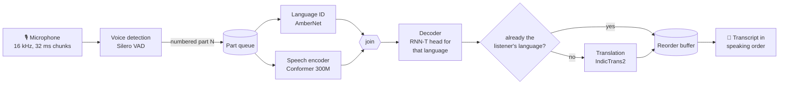

# iTantra STT: offline, code-switching speech-to-text for 10 Indian languages

**Speak in your language, read it in theirs, with no internet.** iTantra's speech-to-text engine runs entirely
on a phone. It listens to a speaker who mixes **Hindi, Gujarati, Marathi, Kannada, Malayalam, Tamil, Telugu,
Odia, Bengali and English** in one conversation, figures out which language each part is in, transcribes it,
and delivers everything in the **one language the listener chose**.

**Try it in your browser: [huggingface.co/spaces/zxnjxd/itantra-stt-browser](https://huggingface.co/spaces/zxnjxd/itantra-stt-browser).**
The models run inside the tab, on your own CPU: nothing is sent to a server. The first visit downloads about 1 GB for
two languages, which is then cached; best on desktop Chrome or Edge. The page has three views: **Try it** (a sample in
your chosen languages, your microphone, or a file), **Language test** (voice detection and language ID across all 10
languages), and **How it works** (the pipeline, with the compute each stage just used).

It is the speech-to-text half of iTantra, an offline, peer-to-peer communication app (STT → mesh network → TTS).
The engine specification is in [`agent-kit/docs/architecture.md`](agent-kit/docs/architecture.md).

```
██████████████░░░░░░░░░░░░░░░░░░░░░░  39% of the final STT product  (10.5 / 27 milestones; details below)
```

---

## Contents

1. [The idea](#1-the-idea)
2. [How it works: the pipeline](#2-how-it-works-the-pipeline)
3. [Making a 4.6 GB pipeline fit a phone](#3-making-a-46-gb-pipeline-fit-a-phone)
4. [Latency](#4-latency)
5. [Memory and storage](#5-memory-and-storage)
6. [Accuracy](#6-accuracy)
7. [Progress: current vs final product](#7-progress-current-vs-final-product)
8. [Engineering findings](#8-engineering-findings)
9. [Run it yourself, offline](#9-run-it-yourself-offline)
10. [Repository layout](#10-repository-layout)

Unless a figure is labelled **measured**, numbers in sections 3–6 are the **final product's targets** from the
iTantra design documents (summarised in [`agent-kit/docs/architecture.md`](agent-kit/docs/architecture.md)). Measurements from the current
reference engine are in section 7 and in [`results/`](results/).

---

## 1. The idea

India's languages are not used one at a time. A rescue worker, a nurse or a shopkeeper will say a sentence in
Tamil, the next in English and answer a question in Hindi. Speech tools that need a fixed language, a good
connection or a cloud account fail exactly where communication matters most: disasters, rural areas, crowded
events.

The final STT product is designed around four constraints:

| Constraint | What it means for the design |
|---|---|
| **Fully offline** | Every model runs on the phone; nothing leaves the device unencrypted |
| **Mixed languages** | Language is detected per spoken part; 2–3 languages per speaker, switching at pauses |
| **One output language** | Translation is part of STT: every part reaches the listener in their language |
| **Cheap phones too** | Two device tiers: high-end (INT8, NPU) and low-end (INT4-mixed, CPU only) |

---

## 2. How it works: the pipeline



| # | Stage | What it does | Model (final) |
|---|---|---|---|
| 1 | **Audio in** | Microphone stream at 16 kHz, cut into 32 ms (512-sample) chunks | — |
| 2 | **Voice detection** | Scores each chunk for speech. A debounced state machine opens a part when speech starts and closes it after 0.4 s of silence (or at 30 s). Each part gets a sequence number | Silero VAD, conv + GRU, 2 MB |
| 3a | **Language ID** | Decides which of the speaker's languages the part is in. Odia and close pairs such as Hindi/Marathi are double-checked by the speech model | AmberNet (TitaNet family), 29M params, INT8 |
| 3b | **Speech encoder** | Turns audio into acoustic features. It is shared by all 9 Indian languages, so it starts **in parallel** with language ID without knowing the language | IndicConformer, distilled 600M → 300M |
| 4 | **Decoder** | Once both 3a and 3b finish, writes the text with the detected language's vocabulary. English parts go to Whisper | Merged RNN-T head (language token) · whisper-tiny.en |
| 5 | **Translation** | Runs only if the part's language differs from the listener's; other parts skip it | IndicTrans2, distilled to the 10 languages |
| 6 | **Ordering** | Parts finish at different speeds (length, language, MT or not). Part N is released only after N−1, so text reads in speaking order. A stuck part is released after a timeout | Reorder buffer |

### Concurrency: seven queueing and parallel points

```
time ─────────────────────────────────────────────────────────────────────►
mic      ████ part 1 ████ ·pause· ████████ part 2 ████████ ·pause· ███ part 3 ███
VAD      runs on its own thread the whole time, never waits for anything downstream     (A)
part 1                    [LID ‖ encoder](B)→join(C)→[decode](D)→[MT](E,F)→release(G)
part 2                                                     [LID ‖ encoder]→[decode]→ skip MT → waits for part 1 (G)
```

| Point | Kind | Purpose |
|---|---|---|
| A | queue | VAD drops finished parts into a bounded queue and keeps listening |
| B | parallel | Language ID and the speech encoder start together on each part |
| C | join | Decoding starts when both are done |
| D | worker pool | 2–3 ASR workers: part N+1 is encoded while part N decodes |
| E | queue + skip | Only parts in a different language than the listener's are queued for translation |
| F | worker pool | Translation workers |
| G | exit gate | Reorder buffer: release in sequence order, timeout for stuck parts |

Queues are bounded: when the device falls behind the pipeline reports it instead of dropping audio.

### Output: one record per part

| Field | Meaning |
|---|---|
| `seq`, `start_ms`, `end_ms` | Part number and position in the stream |
| `language`, `lid_confidence`, `lid_detail` | Detected language, confidence, and how it was decided |
| `text` | Transcript in the spoken language |
| `translation`, `target_language` | Text in the listener's language (when translated) |
| `timings` | Milliseconds per stage, for monitoring |
| `flags` | `unexpected_language`, `forced_cut`, `timeout`, `low_confidence` |

These records are what the networking layer encrypts (ChaCha20-Poly1305) and sends over the mesh.

---

## 3. Making a 4.6 GB pipeline fit a phone

Uncompressed (FP32, all languages bundled) the STT models take about **4.6 GB**: encoder 2.4 GB, translation
1.9 GB, LID and decode heads 0.36 GB. The final product brings one user's STT under 0.75 GB with seven
techniques, each validated per model rather than applied blindly.

| # | Technique | Applied to | Effect |
|---|---|---|---|
| 1 | **On-demand packs** | Decode heads, English, translation | App ships VAD + LID + encoder; only the user's languages are downloaded |
| 2 | **Domain-restricted distillation** | ASR encoder 600M → 300M; translation | Student trained only on the 10 target languages, so capacity isn't spent on unused ones |
| 3 | **Vocabulary pruning** | Translation | IndicTrans2's vocabulary covers 22 languages; 42–59% of each model is vocabulary tables (**measured**) |
| 4 | **Mixed-precision quantization** | Encoder, LID, heads | INT8 everywhere; on low-end, mid/late feed-forward layers in block-wise INT4 with quantization-aware training |
| 5 | **Merged decode head** | ASR heads | One head for the user's 2–3 languages, selected by a language token |
| 6 | **Minimal runtime** | ONNX Runtime Mobile | Custom build with only the operators the shipped models use |
| 7 | **Memory-mapped weights** | All models | Weights are paged in from flash on demand, so idle RAM stays near VAD + LID |

Translation stays at INT8 on both tiers: published 4-bit exports of this model family were larger, slower and
lower quality than INT8.

---

## 4. Latency

**Time-to-text** is measured from the **last word spoken** to **text finalized** on screen. It includes the 0.4 s
of silence the voice detector waits for before closing a part.

| Final product target | High-end phone (INT8, NPU) | Low-end phone (INT4-mixed, CPU) |
|---|---|---|
| Time-to-text, same language, average | **~1.2 s** | **~2.7 s** |
| Time-to-text, with translation, average | **~1.45–1.55 s** | **~2.8–2.9 s** |
| Time-to-text, worst case (30 s continuous speech) | ~1.85 s · ~2.2–2.3 s with translation | ~4.0 s · ~4.1–4.2 s with translation |
| ASR real-time factor (encoder + decoder) | 0.12–0.18 | 0.28–0.40 |
| Idle CPU while listening (VAD only) | 1–3% of one core | 3–6% |

Where the time goes (budget derived from the targets above):

```
high-end, part in another language (≈1.5 s)
├── 0.40 s  voice detection waits for the pause that ends the part
├── ~0.8 s  language ID ‖ speech encoder, then decoder   (ASR RTF 0.12–0.18 × part length)
├── 0.25–0.35 s  translation                              (only for parts in another language)
└── ~0 s    reorder buffer                                (waits only if an earlier part is slower)
```

Parallelism is what keeps this flat: language ID costs no extra time because it runs beside the encoder, parts
in the listener's language skip translation, and part N+1 is processed while part N is still being translated.

---

## 5. Memory and storage

### Per component (final product, one user: 2–3 Indian speaker languages, 1 listener language)

| Component | High-end (INT8) | Low-end (INT4-mixed) | Loaded |
|---|---|---|---|
| Voice detection (Silero VAD) | 2 MB | 2 MB | always |
| Language ID (AmberNet INT8, **measured**) | 30 MB | 30 MB | always |
| Speech encoder (300M Conformer) | 310 MB | 210–220 MB | always |
| Decode head (merged, user's languages) | 12 MB | 7–9 MB | on demand |
| English speech (whisper-tiny.en), only if the speaker uses English | ~40 MB | ~25 MB | on demand |
| Translation (one direction) | 230–340 MB | 230–340 MB | on demand |
| **STT total on flash** | **~0.58–0.69 GB** (+40 MB with English) | **~0.48–0.60 GB** (+25 MB with English) | |

### RAM

| Final product target | High-end | Low-end |
|---|---|---|
| Peak RAM, whole on-device pipeline active (STT + TTS) | ≤ 0.95–1.15 GB | ≤ 0.62–0.77 GB |
| RAM while idle and listening (VAD + LID resident, rest memory-mapped) | 100–120 MB | 85–100 MB |
| Base app install (VAD + LID + app code) | ~75–85 MB | ~58–65 MB |

Memory-mapped weights matter twice: they keep idle RAM low, and under memory pressure the OS can drop and
re-read those pages from flash instead of killing the app.

---

## 6. Accuracy

| Final product target | High-end | Low-end |
|---|---|---|
| Word error rate, average (natural pauses) | 15–18% | 17–20% |
| Word error rate, worst case (30 s without a pause) | 19–23% | 21–26% |
| Language ID error | < 1% (**measured 0.5%** with all 10 languages as candidates) | < 1.5% |
| Translation vs its full-precision model | SacreBLEU ≥ 87 | same (translation stays INT8) |
| Code-switching | 2–3 languages per speaker | up to 2, falls back to one under memory pressure |

---

## 7. Progress: current vs final product

```
██████████████░░░░░░░░░░░░░░░░░░░░░░  39%   (10.5 of 27 milestones; done = 1, partial = ½)
```

| Phase | Milestones | Status |
|---|---|---|
| 1. Foundation | repo scaffold · model fetch + licences · evaluation harness | ◐ ◐ ● |
| 2. Models into ONNX | ASR runner + parity · LID · VAD · INT8 / INT4 quantization | ● ● ● ● |
| 3. Reference engine | audio I/O · scheduler + reorder · pipeline API · CLI · packs + model manager · translation + English · release | ● ● ● ◐ ○ ● ○ |
| 4. Compression training | encoder 600M → 300M · merged head · QAT · LID distillation · MT distillation · weight clustering | ○ ○ ○ ○ ○ ○ |
| 5. Mobile | C++ core · bindings · Android library · Flutter plugin · iOS · on-device benchmarks · release | ○ ○ ○ ○ ○ ○ ○ |

● done · ◐ partial · ○ not started (plan: [`agent-kit/PLAN.md`](agent-kit/PLAN.md)).

| | Current: reference engine, **measured** on a laptop CPU | Final STT product (target) |
|---|---|---|
| Runs on | Python + ONNX Runtime, i7 laptop, CPU only; Streamlit dashboard. Same models in a browser tab (ONNX Runtime Web) | Android (Flutter), C++ core, ONNX Runtime Mobile |
| Speech encoder | 600M, 653 MB INT8 / 511 MB INT4-mixed | 300M distilled, 310 / 210–220 MB |
| Decode heads | One per language, loaded on demand | One merged head |
| ASR word error rate (9 Indian languages) | 19.1% INT8 · 19.4% INT4-mixed | 15–18% · 17–20% |
| Language ID error, all 10 candidates | 0.5% | < 1% |
| Mixed-language recordings vs ideal segmentation | +0 to +2.2 WER points | — |
| Speech → English translation | BLEU 29.4 · chrF++ 57.6 | — |
| Time-to-text with translation / same language | ~1.0 s / ~1.3 s (laptop CPU) | ~1.45–1.55 s / ~1.2 s (high-end phone) |
| Peak RAM, one user's models | ~1.7 GB | ≤ 0.95–1.15 GB (incl. TTS) |

The reference engine already has every stage, all seven concurrency points and both quantized tiers. What
remains is training the smaller models (phase 4) and the mobile build (phase 5). Details:
[`results/`](results/).

---

## 8. Engineering findings

These came from measuring, not assuming. Each has a result file and the command that produced it.

- **Quantization: the loss came from one layer type.** Plain INT8 raised Hindi WER from 8.2% to 11.6%. A
  layer-group sensitivity scan traced it to ONNX Runtime's INT8 *depthwise* convolution. Keeping those 0.2M of
  607M weights in FP32, with per-channel scales elsewhere, brought it back to 8.9%.
  ([`results/quantization.md`](results/quantization.md))
- **Static vs dynamic INT8 for conv nets.** Dynamic INT8 made the language-ID model 3× *slower* than FP32.
  Calibrated static INT8 made it 2.6× faster at the same accuracy.
- **A hidden duplicate in memory.** Translation models load two decoder graphs that share the same weight file,
  and ONNX Runtime pre-packed a private copy for each. Sharing memory-mapped weights and skipping pre-packing
  halved private RAM per translation model (454 → 241 MB). ([`results/memory.md`](results/memory.md))
- **An upstream config that lies.** The ASR model's `config.json` gives start token 256, but its loader never
  reads that file. The effective value is 5632. Only with 5632 did our runner match the reference output
  exactly (9/9 clips).
- **A language the language-ID model doesn't know.** AmberNet has no Odia. When Odia is possible, language ID
  only decides "English or Indian" and the speech model's CTC scores pick the Indian language: Odia went from 0%
  to 100% correct.
- **Cancel work you no longer need.** Language ID and the encoder start together. When language ID says English,
  the encoder run is cancelled mid-flight, cutting English time-to-text from 1.77 s to 1.23 s.
  ([`results/engine-latency.md`](results/engine-latency.md))
- **The browser runs the same models at the same accuracy.** Porting the engine to JavaScript on ONNX Runtime Web
  kept every stage numerically faithful (features bit-exact, text processing 499/499); the only drift is the
  WebAssembly INT8 kernels rounding differently (≈0.5% on activations). Mean WER: 19.07% in the browser vs 19.05%
  native. Matching IndicTrans2's preprocessing meant reproducing two upstream quirks: indic-nlp writes the nukta as
  the literal text `\u093C`, and its tokenizer pattern silently drops backslash from the punctuation set.
  ([`results/browser.md`](results/browser.md))
- **Rejected with data.** Reusing the Indian↔Indian translation model for English input would save ~400 MB but
  measured −10 chrF++ in every language, so it was not adopted.
  ([`results/pipeline-and-translation.md`](results/pipeline-and-translation.md))

---

## 9. Run it yourself, offline

Two ways, both fully on your own machine: the **browser demo** (the models run inside a browser tab, so it is
the closest thing to the on-device product today) and the **Python reference engine** with its dashboard. Both
need the built models in `models/`: download them ready-built or rebuild them (9.2); the browser uses the same files.

### 9.1 In a browser tab (on-device)

Hosted copy: [huggingface.co/spaces/zxnjxd/itantra-stt-browser](https://huggingface.co/spaces/zxnjxd/itantra-stt-browser)
(a static page; models from [zxnjxd/itantra-stt-models](https://huggingface.co/zxnjxd/itantra-stt-models), each under its
upstream licence). It is published with `scripts/publish_web.py`. To run your own copy locally:

```bash
cd web
npm ci
npm run build        # vendors ONNX Runtime Web + tokenizers, writes models.json from ../models, copies demo clips
npm run serve        # http://localhost:8080 (sends the COOP/COEP headers multi-threaded WebAssembly needs)
```

Pick the speaker's languages, the listener's language and the speech-model tier (INT8, or the smaller INT4-mixed);
the page shows the download size first and fetches only those models (Hindi + English → English: about 1 GB with INT8,
871 MB with INT4-mixed). It then runs the same pipeline as the Python engine
(VAD → language ID → IndicConformer or Whisper → IndicTrans2) in a Web Worker with ONNX Runtime Web
(WebAssembly, SIMD, multi-threaded). Models are kept in the browser's Cache Storage, so the next visit loads
without downloading. Once loaded, **switch the network off: it keeps transcribing.**

The side panel shows the computation as it happens: speech processed, compute time, real-time factor, and
**GMAC** (billions of multiply-accumulates) per stage, counted per model run from the real tensor shapes
([`scripts/count_macs.py`](scripts/count_macs.py) → `web/compute.json`). It also counts the network requests made
while transcribing: 0.

Measured in Chromium 152 on the i7-14650HX laptop, 8 WebAssembly threads
([`results/browser.md`](results/browser.md)):

| | Browser (ONNX Runtime Web) | Python engine (native ONNX Runtime) |
|---|---|---|
| English + Hindi + Tamil demo clip (49.5 s of speech), with translation | real-time factor 0.41, 434 GMAC | — |
| All-10-languages clip (61.9 s of speech), with translation | real-time factor 0.61, 664 GMAC | — |
| ASR word error rate, 9 Indian languages (RNN-T, INT8) | 19.07% | 19.05% |
| Same, INT4-mixed speech model (140 MB smaller download) | 19.34% | 19.39% |
| Time-to-text with translation, median (INT8 / INT4-mixed), real-time stream | 2.24 s / 2.64 s | 1.07 s / 2.16 s |
| Peak memory (INT8 / INT4-mixed) | 1.60 / 1.53 GB (tab) | 1.70 / 1.52 GB (process) |
| Model load (Hindi + Tamil + English, from cache) | 7.8 s | 2.6 s (ASR only) |

The JavaScript port matches the Python engine stage by stage: audio features bit-exact, language ID 30/30,
translation pre/post-processing 499/499 and token ids 29/29 identical. Transcripts differ in about 1 word in 80,
because the WebAssembly INT8 kernels round differently from the native ones.

To serve it from a static host, copy `web/` (after `npm run build`) and point it at a models URL with
`?models=https://…/models/` (the model host must allow CORS); `coi-serviceworker` provides cross-origin isolation
where the page's host cannot set headers.

Tests: `node test/parity_asr.mjs`, `parity_text.mjs`, `parity_mt.mjs` (against Python references),
`node test/pipeline.mjs <wav> <langs>` (whole pipeline in Node), `npm run e2e` (headless Chromium against a running
`npm run serve`; `OFFLINE=1` cuts the network after loading).

### 9.2 Python reference engine and dashboard

The reference engine runs on a laptop (Linux, Python 3.10+) and powers the dashboard.

**Quick path:** install, then download the ready-built INT8 models (1.7 GB, public, no gated access or NeMo needed):

```bash
python3 -m venv .venv
.venv/bin/pip install -e ".[ui,dev]" pyarrow IndicTransToolkit
.venv/bin/python scripts/fetch_models.py --prepared zxnjxd/itantra-stt-models
.venv/bin/streamlit run app/streamlit_app.py
```

**Full path:** rebuild every model from upstream (needs IndicConformer's gated access and NeMo for language ID):

```bash
python3 -m venv .venv
.venv/bin/pip install -e ".[ui,dev]" pyarrow IndicTransToolkit onnx_ir

# models (IndicConformer is gated: accept its conditions on Hugging Face first)
.venv/bin/python scripts/fetch_models.py

# AmberNet language ID → ONNX, one-off, needs NeMo in a separate environment
python3 -m venv .venv-nemo
.venv-nemo/bin/pip install torch torchaudio --index-url https://download.pytorch.org/whl/cpu
.venv-nemo/bin/pip install "nemo_toolkit[asr]" onnx onnxruntime
.venv-nemo/bin/python scripts/export_ambernet.py

# test clips (FLEURS, CC-BY-4.0), then quantize: INT8, INT4-mixed, static INT8 language ID
.venv/bin/python scripts/build_smoke_set.py
.venv/bin/python scripts/quantize.py --tier int8 --lid
.venv/bin/python scripts/quantize.py --tier int4mixed

# dashboard
.venv/bin/python scripts/make_demo_clip.py en:0 hi:0 en:1 ta:0 --out data/demo/mixed_en_hi_ta.wav
.venv/bin/python scripts/make_demo_clip.py hi:1 ta:1 bn:1 te:1 mr:1 or:1 kn:1 gu:1 ml:1 en:2 --max-seconds 7 --out data/demo/all10_languages.wav
.venv/bin/streamlit run app/streamlit_app.py --server.address 0.0.0.0
```

The dashboard has three tabs:
- **Try it:** record, upload, examples or live mic; the transcript appears in the chosen language.
- **Language test:** voice-detected chunks tagged with their language on a timeline, all 10 languages.
- **How does this work?:** the pipeline with latency and RAM per stage.

```python
from indicstt.engine import Engine, EngineConfig

eng = Engine(EngineConfig(languages=["hi", "ta", "en"], target_language="en", asr_tier="int8"))
for part in eng.transcribe_file("clip.wav"):
    print(part.seq, part.language, part.text, "→", part.output_text)
```

Tests: `.venv/bin/pytest -q`. Add `INDICSTT_MODELS=1` for tests with real models, including a 1,000-run
randomized stress test of the scheduler and a concurrent-users test.

---

## 10. Repository layout

```
src/indicstt/      engine: audio, vad, features, lid, asr, english, mt, scheduler, engine, segment, ortutil, evaluation
app/               Streamlit dashboard
web/               browser demo: the engine ported to JavaScript (ONNX Runtime Web), page, worker, Node + Chromium tests
scripts/           fetch, export, quantize, build test sets, evaluate (ASR, LID, pipeline, MT), benchmark, memory
tests/             unit tests (no downloads needed) and real-model tests
results/           every measurement with the command that produced it
agent-kit/         engine specification and module plan
```

**Licences.** Code: Apache-2.0. Models: IndicConformer (MIT, gated), IndicTrans2 (MIT), Whisper (MIT),
Silero VAD (MIT), AmberNet (NVIDIA NGC Terms of Use; check before redistributing). Test audio: FLEURS (CC-BY-4.0).
